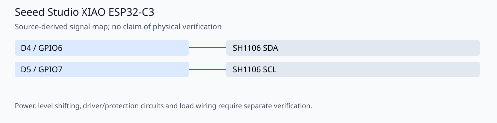

# ESP32-C3 Idea Beacon

A local Wi-Fi idea-submission portal, SH1106 OLED quote display and BLE advertiser by **Amir Mobasheraghdam**. It stores quotes, messages, display settings and a generated admin PIN in ESP32 Preferences.

## Reproducible build

Install Python 3 and **Arduino CLI 1.3.1**, then run from this repository:

```bash
python3 tools/check_firmware.py --install
```

The helper installs `esp32:esp32@2.0.17` and `U8g2@2.36.19`. It compiles these alternatives
separately in temporary folders, without uploading or rewriting the originals:

- `AMIR_IDEA_BEACON.ino`

Build target: `esp32:esp32:XIAO_ESP32C3:PartitionScheme=no_ota`. Once dependencies are installed, omit `--install`
to build offline. `--jobs 2` is the default. Set `ARDUINO_CLI` to a CLI executable
or wrapper when using a custom Arduino configuration. Exact build inputs are in
[`tools/firmware.json`](tools/firmware.json). Library dependencies are listed
explicitly and installed with `--no-deps` so transitive updates cannot silently
replace the pinned versions. These are tested build versions, not a claim that
all other core/library versions are incompatible.

The GitHub Actions workflow repeats the firmware checks on pushes and pull
requests. Compilation validates software/toolchain compatibility; it does not
establish hardware safety or successful physical operation.

## Signal assignments



| Signal | Board pin |
| --- | --- |
| SH1106 SDA | D4 / GPIO6 |
| SH1106 SCL | D5 / GPIO7 |

## Operation and validation limits

The I2C assignments are verified against the **XIAO ESP32-C3 variant in Arduino-ESP32 2.0.17** and the sketch uses `Wire.begin()` without overrides. They are not generic ESP32 pin numbers. Check OLED power/logic compatibility; the code selects a 128×64 SH1106, with an SSD1306 constructor shown as an alternative.

The default 1,310,720-byte app partition is too small: the baseline build uses about 1.45 MB. `tools/firmware.json` selects **No OTA (2 MB APP)** on the 4 MB XIAO target. Select the same partition in Arduino IDE. This sketch has no OTA updater. Back up data before changing flash layout; the checks compile only and do not flash or erase a device.

On first boot the OLED shows a generated six-digit admin PIN for 12 seconds. Connect to the open **Amir-Message** AP and visit **http://10.77.0.1/**, or `/admin` for administration. Store the PIN securely; do not commit it. The admin page supports changing it. Erasing NVS also erases stored content. The local PIN/session/CSRF protections are not a claim of Internet-facing security. `STATIC_CHECKS.json` is historical static-review output, not an executed firmware test suite.

No physical testing, new hardware photographs or measured electrical/optical
performance is claimed. Retain the author attribution and existing license/source
notices when reusing the project.
